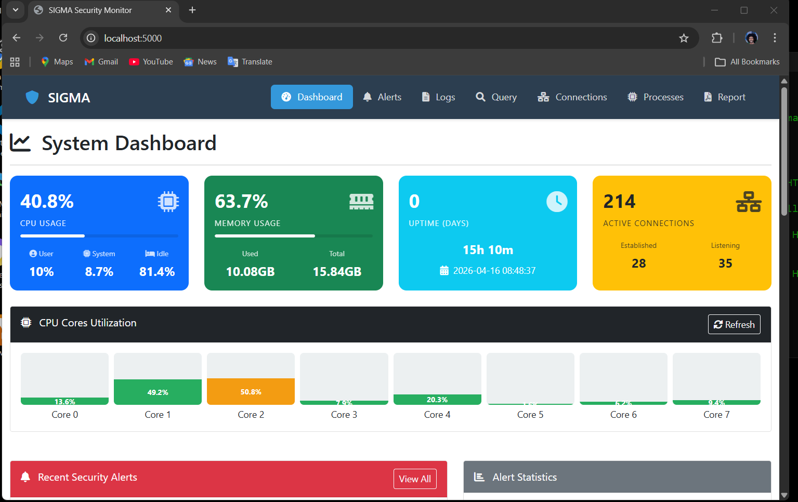
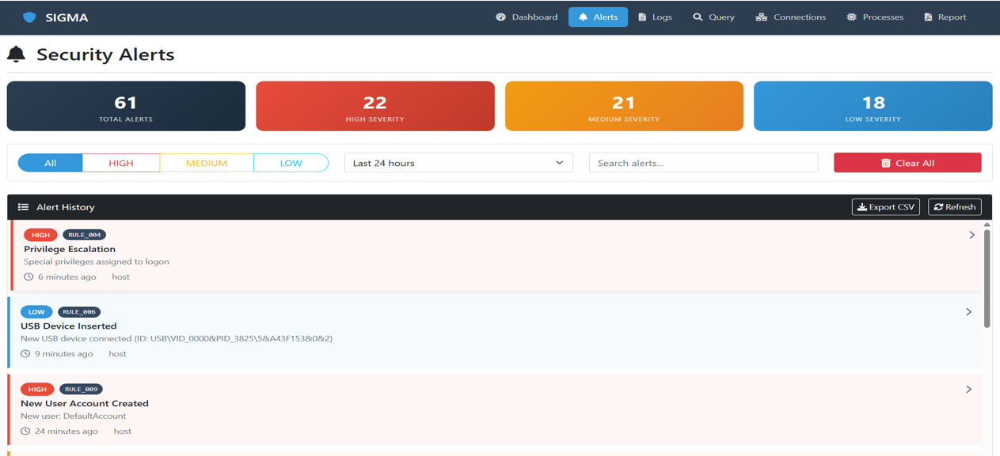
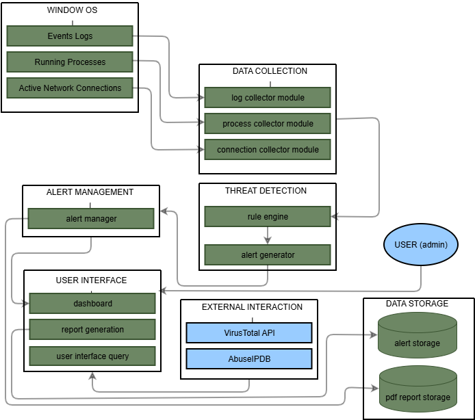

# SIGMA (Security Information Gathering & Monitoring System)


## Overview

**SIGMA** is a lightweight, rule-based Security Information and Event Management (SIEM) tool designed specifically for Windows workstations.

I built this project to address alert fatigue and manual log correlation. Junior SOC analysts and small organizations often struggle with complex, expensive enterprise SIEMs or are forced to manually piece together raw Windows Event Logs. SIGMA provides a free, local application that automatically collects logs, monitors system activity, detects threats, enriches data with threat intelligence, and displays it on a real-time web dashboard.

## The Problem I Solved

Junior analysts face three interconnected challenges:
1. **Alert Fatigue:** Overwhelmed by thousands of daily alerts, causing genuine threats to slip through.
2. **Manual Correlation:** Investigative processes require switching between event logs, process lists, network connections, and external threat intel platforms.
3. **Steep Learning Curve:** Extracting meaning from raw Windows Event IDs requires specialized knowledge.

SIGMA bridges the gap between basic log viewers and massive enterprise SIEMs, providing automated visibility and context for a single host.

## Project Goals and Stakeholders

The project explores how to collect and structure Windows Event Logs, detect common attack patterns with locally available data, enrich indicators with threat intelligence, and present results in a useful web interface.

It is intended to benefit:
- **Junior SOC analysts:** Automates routine monitoring and adds context to alerts so analysts can focus on more complex investigations.
- **Small and medium organizations:** Offers a lightweight security-monitoring option for organizations with limited budgets.
- **Security students and educators:** Provides a practical reference for log collection, rule-based detection, threat intelligence, and dashboard development.
- **Researchers:** Documents practical Windows security-monitoring approaches and provides hands-on experience with security tool development.

## Key Features

- **Automated Log Collection:** Continuously parses Security, System, and Application Windows Event Logs using `pywin32`.
- **Real-time System Monitoring:** Tracks running processes, CPU/Memory usage, and active network connections via `psutil`.
- **Custom Rule-Based Detection Engine:** Implements 9 core detection rules (e.g., Brute Force, Privilege Escalation, Service Installation) with a cooldown mechanism to prevent alert flooding.
- **Threat Intelligence Integration:** Automatically extracts remote IP addresses and queries the **VirusTotal API** to check for malicious reputation, respecting free-tier rate limits and caching results.
- **Real-Time Web Dashboard:** A Flask backend paired with WebSockets (Flask-SocketIO) for instant alert notifications without refreshing the page.
- **Professional Reporting:** Generates downloadable PDF security reports (using ReportLab) with executive summaries and actionable recommendations.
- **Persistent Storage:** Saves alerts in JSON format, ensuring historical analysis survives system reboots.

## System Architecture & Modules

I designed the system using a modular architecture to keep the codebase clean and scalable:

1. **Log Collector (`log_collector.py`):** Reads and parses Windows event logs.
2. **System Monitor (`system_monitor.py`):** Retrieves process lists and network connections.
3. **Rule Engine (`rule_engine.py`):** Analyzes data against security rules and handles alert cooldowns.
4. **Alert Manager (`alert_manager.py`):** Manages alert state and persists them to `alerts.json`.
5. **Threat Intel (`virus_total.py`):** Handles API requests and caching for VirusTotal IP lookups.
6. **Report Generator (`report_generator.py`):** Creates PDF incident/compliance reports.
7. **Web Interface (`routes.py` & `templates/`):** Flask backend serving the Bootstrap-based dashboard UI.

## Screenshots & Demonstration

**Real-time Dashboard**


**Alert Management & VirusTotal Enrichment**


**System Architecture (Level 1 Data Flow Diagram)**


## Tech Stack

- **Backend:** Python 3.9+, Flask, Flask-SocketIO
- **Windows Integration:** `pywin32`, `psutil`
- **Frontend:** HTML5, CSS3, Bootstrap 5, JavaScript (jQuery)
- **Reporting:** ReportLab
- **APIs:** VirusTotal API v3

## Installation & Setup

### Prerequisites
- Windows 10 or Windows 11
- Python 3.9 or higher
- Administrator privileges (required to read Security Event Logs)

### Step-by-Step Guide

1. **Clone the repository:**
   ```bash
   git clone https://github.com/EspoirBlack/SIGMA_project.git
   cd SIGMA_project
   ```
